<div align="center">
  
  <h1>🏙️ UrbanInspect</h1>
  <p><em>App móvil de campo para los inspectores del Municipio de Quito: consulta, registro y actualización de incidencias de infraestructura urbana con evidencia fotográfica, ubicación GPS y consulta de clima en vivo. Prueba I — Integración de APIs y Capacitor · ESFOT.</em></p>

  <p>
    
    
    
    
    
    
    
    
  </p>
</div>

---

## 📖 Descripción del Proyecto

**UrbanInspect** es la herramienta de campo para inspectores municipales en el Distrito Metropolitano de Quito: desde el teléfono se **consultan** las incidencias de infraestructura urbana (luminarias dañadas, baches, señalización deteriorada, alcantarillas obstruidas y daños en parques), se **registra** una nueva con fotografía y coordenadas GPS, y se **actualiza** su estado técnico — todo contra una API REST de oficina simulada y con consulta a una API meteorológica externa real antes de guardar.

Los **10 requisitos** de la Prueba I están implementados al 100%:

1. **Consulta de incidencias (R2):** listado con los **8 campos** requeridos (código `INC-<id>`, tipo, descripción, dirección, sector, fecha, estado y fotografía si existe) con estados visuales diferenciados de **carga** (skeleton animated), **vacío** (200 con `[]`) y **error** con reintento — 404 ≠ caída de red.

2. **Carga progresiva (R3):** paginación **remota real** con `?page=&limit=10`, `ion-infinite-scroll` con llamada a `complete()` garantizada en `finally`, deduplicación por `Set` de IDs (evitando colisiones `NG0955`) y **fin de datos honesto**: `hasMore = items.length === pageSize` — cuando se agota el catálogo, **cero peticiones adicionales**.

3. **Detalle y reglas de estado (R9):** transiciones de ciclo de vida permitidas `pendiente → en proceso → resuelta` (y `en proceso → resuelta`); **una incidencia resuelta nunca retrocede**; para resolver es **estrictamente obligatoria la observación técnica**; el cambio se persiste con `PATCH` y se verifica en la API.

4. **Registro de incidencias (R5):** tipo, descripción, dirección, sector y prioridad validados **antes** de enviar; en prioridad **alta la fotografía es obligatoria** (sin foto el sistema impide guardar), en baja/media es opcional; el alta persiste en la API (`POST`) y se refleja de inmediato.

5. **Evidencia fotográfica (R6):** captura con la cámara nativa del dispositivo y **previsualización obligatoria antes de guardar**; cancelar la captura **no borra** el formulario; permiso denegado explicado al usuario e impide guardar incompleto; la foto viaja en **base64 dentro del registro** (comprimida a ≤ 70 KB para evitar `413 Payload Too Large`) y se visualiza en el detalle tras guardar.

6. **Ubicación (R7):** coordenadas actuales con `@capacitor/geolocation`; en incidencias de tipo **Bache son obligatorias** — si el GPS falla o el permiso es denegado se pueden ingresar **coordenadas manuales válidas** (lat −90..90, lon −180..180 en WGS84); en los demás tipos son opcionales y siempre se respalda la dirección textual.

7. **Borrador recuperable (R8):** autoguardado con *debounce* en `@capacitor/preferences`; si la aplicación se cierra inesperadamente con el formulario a medio redactar, al reabrirla ofrece **Continuar / Descartar** conservando los datos ingresados.

8. **Clima real antes de guardar (R4):** consulta a **Open-Meteo** (API meteorológica externa real, distinta a la de incidencias) con las coordenadas del incidente: temperatura actual, **precipitación de la última hora (mm)** y descripción del estado atmosférico; aviso si supera **5 mm/h sin bloquear el guardado**; ante fallos de conectividad informa al usuario y permite continuar.

9. **Seguimiento local (R1):** permite marcar y desmarcar incidencias para inspección prioritaria; los códigos (únicamente IDs para optimizar almacenamiento) **persisten al reiniciar la app** mediante Preferences; cuenta con una vista propia que lista únicamente las marcadas; al desmarcar desaparecen de esa vista **sin alterar la API de oficina**.

10. **Navegación y APK (R10):** pantalla de inicio con **indicadores reactivos** que reflejan altas y actualizaciones en vivo, navegación fluida (inicio → listado → detalle → registro → seguimiento), interfaz diseñada para **trabajo en campo** (alto contraste para luz solar, targets táctiles ≥ 44 px) y **APK instalable** compilado directamente por terminal.

---

## ✨ Características Principales

- 🏛️ **Datos reales, no simulados:** 26 incidencias sembradas en **MockAPI** (sectores reales de Quito, los 3 estados del flujo, 3 prioridades y los 5 tipos de falla urbana) servidas en lotes de 10; el `POST`/`PATCH` del inspector **persiste de verdad** y se lee en subsiguientes consultas.
- ♾️ **Paginación honesta y blindada:** el fin de datos se determina a partir del tamaño de página (MockAPI no emite cabecera `X-Total-Count`); nunca se simula repitiendo peticiones y la página 4 jamás se solicita al agotarse el catálogo.
- 🧭 **Diferenciación precisa de errores:** `HttpClient` clasifica caída de red (`status 0`), recurso inexistente (`404`), cuota excedida (`429`) y payload excesivo (`413`) — cada uno con mensaje claro y opción de reintento.
- 📸 **Fotografía optimizada para API:** la imagen se redimensiona y comprime en el cliente mediante escalonado en canvas hasta **≤ 70 KB** y viaja serializada en **base64 dentro del campo `foto`** — visible en el detalle tanto en móvil como en navegador sin depender de rutas temporales del sistema de archivos local.
- 🌧️ **Clima externo que no bloquea:** Open-Meteo proporciona `current.precipitation` (**mm de la última hora**); ante precipitaciones superiores a **5 mm/h** emite una alerta preventiva indicando riesgo en la reparación, pero permite continuar con el registro. Si la API de clima no responde, la app no se cuelga ni bloquea al usuario.
- ⭐ **Seguimiento 100 % local y liviano:** almacena exclusivamente IDs en `@capacitor/preferences` (los registros viven en la base de datos de la API); la vista de seguimiento consulta los datos en vivo, reflejando siempre los últimos cambios de estado.
- 🎨 **Diseño adaptado para campo:** tema municipal de alto contraste optimizado para lectura **a plena luz del sol**, con paleta cromática en `variables.scss`, badges temáticos de estado y botones con áreas táctiles ≥ 44 px.
- ⚡ **Angular 22 moderno:** componentes standalone, rutas perezosas con `loadComponent`, arquitectura reactiva basada en Signals, zoneless change detection, control flow nativo (`@if`, `@for`, `@let`) y un único punto de inyección HTTP (`provideHttpClient(withFetch())`).

---

## 🏗️ Arquitectura del Sistema

```mermaid
graph TD
    subgraph App ["App Móvil — Ionic 9 + Angular 22 standalone + Capacitor 8"]
        Inicio["InicioPage<br/>indicadores reactivos · accesos"]
        Listado["ListadoPage<br/>8 campos · infinite scroll · estados"]
        Detalle["DetallePage<br/>transiciones de estado · observación"]
        Registro["RegistroPage<br/>validaciones · cámara · GPS · clima · borrador"]
        Seg["SeguimientoPage<br/>solo ids marcados"]
        IncSvc["IncidenciasService<br/>ÚNICO punto HTTP de oficina"]
        CamSvc["CamaraService<br/>captura + compresión ≤ 70 KB"]
        UbicSvc["UbicacionService<br/>GPS + validación WGS84"]
        ClimaSvc["ClimaService<br/>Open-Meteo + códigos WMO"]
        SegSvc["SeguimientoService<br/>Preferences · solo ids"]
        BorrSvc["BorradorService<br/>Preferences · borrador"]
        CloudSvc["CloudinaryService<br/>CDN imágenes + fallback"]
        Model["models/incidencia.model.ts<br/>Incidencia · ESTADOS · SIGUIENTE_ESTADO"]
    end

    subgraph API ["API de oficina simulada — MockAPI"]
        Lista["GET /API?page=&limit=<br/>paginación remota (R3)"]
        Alta["POST /API<br/>alta real (R5)"]
        Patch["PATCH /API/:id<br/>estado + observación (R9)"]
    end

    subgraph Ext ["APIs externas reales"]
        Clim["Open-Meteo<br/>GET /v1/forecast (R4)"]
        Cloud["Cloudinary CDN<br/>POST /image/upload (R6)"]
    end

    subgraph Movil ["Plataforma Android"]
        Webview["WebView (www/)"]
        Prefs["Capacitor Preferences<br/>seguimiento + borrador"]
        Perm["Permisos Android<br/>cámara · ubicación"]
    end

    Listado --> IncSvc
    Detalle --> IncSvc
    Registro --> IncSvc
    Inicio --> IncSvc
    Seg --> IncSvc
    Seg --> SegSvc
    Registro --> CamSvc
    Registro --> UbicSvc
    Registro --> ClimaSvc
    Registro --> CloudSvc
    Registro --> BorrSvc
    IncSvc --> Lista
    IncSvc --> Alta
    IncSvc --> Patch
    ClimaSvc --> Clim
    CloudSvc -.-> Cloud
    BorrSvc -.-> Prefs
    SegSvc -.-> Prefs
    Perm -.-> CamSvc
    Perm -.-> UbicSvc
    Webview --> App
```



**Reglas de la arquitectura (las que sostienen el código):**

- **Un solo archivo con `HttpClient`** (`IncidenciasService`) y **un solo servicio por plugin nativo** (`CamaraService`, `UbicacionService`, `SeguimientoService`, `BorradorService`); ninguna página realiza llamadas HTTP crudas.
- Las reglas de negocio radican en el **modelo tipado compartido**: `SIGUIENTE_ESTADO` (R9), `prioridadExigeFoto()` (R5) y `esBache()` (R7) — los componentes consumen el contrato sin duplicar lógica.
- Persistencia local **estrictamente de IDs y del borrador temporal** (R1/R8); no se duplican entidades de servidor en el almacenamiento del dispositivo.
- Todas las vistas se cargan de forma diferida (*lazy loading*) mediante `loadComponent` para mantener un inicio instantáneo.

---

## 🛠️ Tecnologías Usadas

### App móvil
- **Framework:** Ionic 9 (componentes standalone) + Angular 22.2 (signals, *zoneless*, rutas *lazy*, control flow `@if/@for`)
- **Nativo:** Capacitor 8.6 — `@capacitor/camera`, `@capacitor/geolocation`, `@capacitor/preferences`
- **HTTP:** `HttpClient` + `withFetch()`, configurado centralmente en `app.config.ts`
- **Estado:** signals reactivos de Angular (`incidencias`, `cargando`, `error`, `hasMore`, `enviando`)
- **Iconos:** `ionicons` registrados estáticamente con `addIcons()` en `main.ts` (cero peticiones de red en runtime)

### Calidad y Pruebas
- **Compilación:** `ng build` → **0 errores, 0 warnings** (budget de estilos optimizado a 2 kB / 4 kB)
- **Tests Unitarios:** Vitest 5 + Angular Testing → **97/97 tests en 13 suites** (servicios con `HttpTestingController` real, validaciones y reglas de negocio sin `.skip`)
- **Tests E2E:** Playwright en emulación móvil (*Mobile Chrome*) → **2/2 pasados**
- **Tipos:** `tsc --noEmit` sobre `tsconfig.app.json` y `tsconfig.spec.json` → **0 errores**
- **Linting:** ESLint + `angular-eslint` (`--max-warnings 0`) + comprobación Prettier → **pass**
- **Seguridad:** `npm audit` → **0 vulnerabilidades** (override de `vite ^8.3.5`)
- **Plataforma Android:** Gradle 8.14.3 + JDK 21 (Temurin), compilación **por terminal** sin Android Studio

### APIs
- **Oficina:** **MockAPI** → `https://6ae2831abbb541292299fd5e.mockapi.io/API` — paginación remota real (`?page=&limit=10`), persistencia verídica en operaciones `POST`/`PATCH` y CORS abierto (`ACAO: *`).
- **Clima:** **Open-Meteo** → `https://api.open-meteo.com/v1/forecast` — sin requerimiento de API Key, CORS abierto, `current.temperature_2m`, `current.precipitation` (mm en la última hora) y `current.weather_code` (WMO internacional).
- **Imágenes:** **Cloudinary** → `https://api.cloudinary.com/v1_1/btmr3o2b/image/upload` — almacenamiento CDN con firma SHA-1 y respaldo automático en Base64.

---

## 🌐 APIs y Decisiones Clave

```text
Listado     GET https://6ae2831abbb541292299fd5e.mockapi.io/API
              ?page=1..N&limit=10          → 10 · 10 · 6  y  page=4 → []

Detalle     GET .../API/:id
Alta        POST .../API                   → 201 con id numérico → código INC-<id>
Estado      PATCH .../API/:id              → { estado, observacion }

Clima       GET https://api.open-meteo.com/v1/forecast
              ?latitude=..&longitude=..&current=temperature_2m,precipitation,weather_code
              &timezone=auto
```

| Decisión | Implementación |
|---|---|
| **Fin de datos** | `hasMore = items.length === pageSize` — MockAPI no provee `X-Total-Count`; una página corta detiene el scroll de forma definitiva. |
| **Avance de página** | `page + 1` calculado únicamente tras recibir datos satisfactorios; si la página está incompleta, no se piden más. |
| **Sin duplicados** | `Set<string>` para deduplicación por ID, aplicado también sobre los elementos de la página recibida (evita `NG0955`). |
| **Sin peticiones en vuelo simultáneas** | Guard booleano activado síncronamente antes de la llamada asíncrona para evitar saturación del scroll. |
| **Recuperación segura** | `complete()` del `ion-infinite-scroll` llamado invariablemente en el bloque `finally`; `[disabled]` incluye `error()` para evitar bucles. |
| **Vacío ≠ error** | Código `200` con arreglo vacío `[]` activa el panel de lista vacía; el bloque `catch` activa el panel de fallo con botón de reintento. |
| **404 ≠ caída de red** | `status 0` corresponde a fallo de conectividad; `404` a recurso no encontrado; `429` a cuota agotada; `413` a imagen sobrepasada. |
| **Fotografía** | Codificación base64 en `foto`, limitada a **≤ 70 KB** mediante compresión adaptativa en canvas (evita el límite de 100 KB de MockAPI). |
| **Identificador** | Formato `INC-<id>` basado en el ID numérico del recurso — garantiza unicidad para seguimiento y navegación directa. |
| **Clima** | Consulta a Open-Meteo basada en las coordenadas de la incidencia; alerta preventiva si la lluvia supera los 5 mm/h **sin impedir el registro**. |

---

## 🚀 Instalación y Ejecución Local

### 1. Clonar el repositorio
```bash
git clone https://github.com/JimSul16/IniMoviles2026B.git
cd IniMoviles2026B
```

### 2. Instalar dependencias
```bash
npm install
```
> Requisitos verificados: **Node 22** (npm 10), y para la compilación del APK nativo, **JDK 21** + Android SDK (configurado en `android/local.properties`).

### 3. Ejecutar en el navegador
```bash
npm start                # ng serve → http://localhost:4200
# o alternativamente con Ionic CLI:
npx ionic serve
```

### 4. Ejecutar las suites de verificación
```bash
npm run test:unit         # Vitest → 93/93 tests unitarios
npm run test:e2e          # Playwright → 2/2 tests de integración móvil
npx tsc -p tsconfig.app.json --noEmit   # Verificación de tipos app (0 errores)
npx tsc -p tsconfig.spec.json --noEmit  # Verificación de tipos test (0 errores)
npm run lint              # ESLint con 0 warnings + Prettier
npm run build             # Build de producción para Angular (directorio www/)
```

---

## 📦 Compilación del APK (por terminal)

Para compilar la aplicación nativa para Android directamente desde la terminal:

```bash
npm run build                 # 1. Compilar los assets web hacia www/
npx cap sync android          # 2. Sincronizar el proyecto nativo Capacitor
cd android
.\gradlew.bat assembleDebug   # 3. Compilar el APK debug en Windows (./gradlew assembleDebug en Linux/macOS)
```

**Ubicación de salida:**
`android\app\build\outputs\apk\debug\app-debug.apk`
✅ **Generado y verificado: 8,58 MB (8 995 584 bytes)** — `BUILD SUCCESSFUL` en 3 s sobre el estado final con 93/93 tests pasados.

> Se incluye una copia versionada lista para instalación en [`releases/urbaninspect-debug.apk`](releases/urbaninspect-debug.apk).

Para instalar en el dispositivo físico o emulador conectado por USB/Wi-Fi:
```bash
adb install -r android\app\build\outputs\apk\debug\app-debug.apk
# o directamente desde la carpeta releases:
adb install -r releases\urbaninspect-debug.apk
```

> **Permisos de Android:** Declarados en `android/app/src/main/AndroidManifest.xml` (`CAMERA`, `ACCESS_FINE_LOCATION`, `ACCESS_COARSE_LOCATION`, `INTERNET`). Si el usuario rechaza los permisos en tiempo de ejecución, la aplicación gestiona la denegación informando claramente y habilitando el ingreso manual de coordenadas.

### ⚙️ CI/CD en GitHub Actions

El repositorio cuenta con el flujo automatizado [`.github/workflows/build-apk.yml`](.github/workflows/build-apk.yml) que compila el APK en servidores de GitHub en cada `push` a la rama `main` (o manualmente vía `workflow_dispatch`), generando el artefacto descargable `urbaninspect-debug`.

---

## 📁 Estructura del Proyecto

```text
src/app/
├── app.routes.ts                  rutas lazy: inicio · incidencias · seguimiento · incidencia/:id · registro
├── app.config.ts                  configuración standalone: provideHttpClient(withFetch())
├── models/
│   └── incidencia.model.ts        Incidencia · TIPOS/ESTADOS/PRIORIDADES · SIGUIENTE_ESTADO · helpers
├── services/                      servicios desacoplados para HTTP y capacidades nativas
│   ├── incidencias.service.ts     MockAPI: listado paginado, detalle, alta POST, actualización PATCH
│   ├── camara.service.ts          captura nativa + compresión ≤ 70 KB + cancelación segura
│   ├── ubicacion.service.ts       geolocalización GPS + validación de coordenadas WGS84
│   ├── clima.service.ts           Open-Meteo + interpretación de códigos WMO
│   ├── cloudinary.service.ts      Cloudinary CDN + subida firmada SHA-1 con fallback
│   ├── seguimiento.service.ts     Capacitor Preferences · persistencia local de IDs marcados
│   └── borrador.service.ts        Capacitor Preferences · respaldo y recuperación de borrador
└── pages/
    ├── inicio/                    indicadores reactivos de gestión urbana + accesos directos (R10)
    ├── listado/                   listado con 8 campos · infinite scroll · carga/vacío/error (R2, R3)
    ├── detalle/                   ficha técnica · transiciones de estado · observación obligatoria (R9)
    ├── registro/                  formulario · validaciones · cámara · GPS · clima · borrador (R5, R6, R7, R8, R4)
    └── seguimiento/               vista propia de incidencias en seguimiento local (R1)

src/theme/variables.scss           paleta cromática institucional de alto contraste (modo claro / oscuro)
src/global.scss                    estilos globales y variables de accesibilidad
src/main.ts                        inicialización standalone y registro de addIcons()
src/environments/                  configuración de endpoints MockAPI y Open-Meteo

android/                           proyecto nativo Android con permisos configurados
.github/workflows/build-apk.yml    pipeline CI/CD para compilación de APK en GitHub Actions
releases/urbaninspect-debug.apk    APK debug compilado y versionado para descarga directa
screenshots/                       directorio de evidencias fotográficas de la aplicación
```

---

## ✅ Requisitos de la Prueba I (Rúbrica EPN · ESFOT)

| # | Requisito Evaluado | Puntos | Estado |
|---|---|:---:|:---:|
| **R1** | Seguimiento local persistente con vista propia | 0,8 | ✅ Implementado |
| **R2** | Listado con los 8 campos + estados de vacío y fallo | 1,6 | ✅ Implementado |
| **R3** | Carga progresiva remota, incremental y sin duplicados | 1,6 | ✅ Implementado |
| **R4** | Clima real externo antes de guardar (aviso preventivo > 5 mm/h) | 0,8 | ✅ Implementado |
| **R5** | Registro con validaciones; prioridad alta exige foto obligatoria | 1,6 | ✅ Implementado |
| **R6** | Evidencia fotográfica: captura, previsualización, cancelar y permisos | 1,6 | ✅ Implementado |
| **R7** | Ubicación GPS + coordenadas manuales obligatorias para baches | 1,2 | ✅ Implementado |
| **R8** | Borrador recuperable en Preferences (continuar / descartar) | 1,2 | ✅ Implementado |
| **R9** | Detalle con transiciones válidas y observación obligatoria | 1,6 | ✅ Implementado |
| **R10** | Inicio con indicadores reactivos, navegación clara y APK instalado | 0,8 | ✅ Implementado |

**Subtotal Funcional:** **12,8 / 12,8 puntos** · Defensa oral: 3,2 puntos.

---

## 🧩 Dificultades y Decisiones Técnicas

- **MockAPI sin cabecera `X-Total-Count`:** La API simulada no provee el total de elementos en cabeceras HTTP. Se implementó una lógica de detección basada en el tamaño de la respuesta recibida (`items.length === pageSize`). Cuando una página devuelve menos elementos que el límite establecido, se desactiva el scroll evitando peticiones infinitas o estados incoherentes.
- **Limitación en el nombre del recurso MockAPI:** El plan gratuito de MockAPI no permite renombrar endpoints ya creados (quedando como `/API`). Se documenta la equivalencia funcional plena con el recurso `/incidencias` requerido en la rúbrica.
- **Control de peso de imagen ante HTTP 413:** Pruebas directas contra MockAPI demostraron que cargas superiores a 100 KB producían `413 Payload Too Large`. Se incorporó una compresión automática en cliente mediante canvas HTML5 escalando resolución y calidad hasta asegurar que el base64 nunca exceda los **70 KB**.
- **Manejo del scroll ante errores:** Si `complete()` no se ejecuta dentro de un bloque `finally`, el componente `ion-infinite-scroll` queda congelado. Se aseguró la liberación del evento y se agregó la condición `error()` a la propiedad `[disabled]` para evitar bucles continuos de recarga.
- **Permisos nativos en AndroidManifest:** El plugin `@capacitor/geolocation` requiere explícitamente los permisos `ACCESS_FINE_LOCATION` y `ACCESS_COARSE_LOCATION` en el manifiesto nativo para operar en Android. Se agregaron junto al permiso de `CAMERA`, diseñando la aplicación para reaccionar ante denegaciones permitiendo el ingreso manual de coordenadas WGS84.
- **Clima sin simulación estática:** En cumplimiento estricto de la rúbrica, el servicio `ClimaService` consume directamente la API meteorológica real de Open-Meteo. Ante fallos de conexión, emite un error tipado para alertar al usuario sin bloquear la capacidad de guardar la incidencia.
- **Rendimiento e indicadores en pantalla principal:** La pantalla de inicio realiza una lectura de consolidación de hasta 100 registros para calcular de forma fidedigna el desglose de incidencias por estado (pendientes, en proceso, resueltas).
- **Legibilidad para trabajo de campo en exteriores:** Se diseñaron estilos con alto ratio de contraste (superior a 12:1 en modo oscuro y 17:1 en modo claro) adaptados a la visualización de inspectores bajo luz solar intensa.

---

## 📝 Evidencias

| Verificación Técnica | Comando Ejecutado | Resultado Obtenido |
|---|---|:---:|
| Build Web de Producción | `npm run build` | ✅ 0 errores, 0 warnings |
| Chequeo de Tipos TypeScript (App) | `npx tsc -p tsconfig.app.json --noEmit` | ✅ 0 errores |
| Chequeo de Tipos TypeScript (Tests) | `npx tsc -p tsconfig.spec.json --noEmit` | ✅ 0 errores |
| Análisis Estático y Formato | `npm run lint` | ✅ Todos los archivos aprobados |
| Pruebas Unitarias Automatizadas | `npm run test:unit` | ✅ **97/97 pasadas** (Vitest) |
| Pruebas E2E en Emulación Móvil | `npm run test:e2e` | ✅ **2/2 pasadas** (Playwright) |
| Auditoría de Dependencias | `npm audit` | ✅ **0 vulnerabilidades** |
| Compilación del APK Nativo | `.\gradlew.bat assembleDebug` | ✅ **BUILD SUCCESSFUL** (8,58 MB) |

### 📸 Capturas de la entrega

> App en ejecución con **datos en vivo de MockAPI y Open-Meteo** · Octubre 2026 · tema municipal de alto contraste.

**1 · Inicio con indicadores reactivos (R10)** — conteo en vivo de incidencias de la oficina municipal con desglose por estado (pendientes, en proceso, resueltas):


**2 · Listado con los 8 campos requeridos (R2)** — código `INC-<id>`, tipo, descripción, dirección, sector, fecha, estado y fotografía:


**3 · Carga progresiva e infinite scroll con fin de datos (R3)** — paginación remota incremental de 10 en 10, sin duplicados y con parada honesta:


**4 · Detalle con transición de estado y observación obligatoria (R9)** — transición permitida (`pendiente` → `en proceso` → `resuelta`) persistida con `PATCH`:


**5 · Formulario de registro con validaciones (R5)** — campos obligatorios validados y alta persistida con `POST`:


**6 · Evidencia fotográfica previsualizada (R6)** — captura con cámara nativa, previsualización antes de guardar y compresión base64:


**7 · Ubicación GPS / coordenadas manuales en bache (R7)** — geolocalización o coordenadas manuales obligatorias para tipo Bache:


**8 · Consulta de clima antes de guardar con aviso de lluvia (R4)** — llamada externa a Open-Meteo, aviso preventivo si la precipitación supera 5 mm/h sin bloquear:


**9 · Recuperación de borrador local (R8)** — autoguardado en Preferences y diálogo para continuar o descartar al reabrir la app:


**10 · Seguimiento local persistente (R1)** — vista propia con únicamente las incidencias marcadas (almacenadas solo como IDs en Preferences):


**11 · APK instalado en el dispositivo (R10)** — aplicación UrbanInspect instalada en el cajón de aplicaciones Android (compilada por terminal):


---

<div align="center">
  <p><em>🧩 Prueba I de <strong>Desarrollo de Aplicaciones Móviles</strong> — Escuela Politécnica Nacional (EPN · ESFOT)</em></p>
  <p><em>⚙️ Desarrollado con 🟦 MiMo (infraestructura, build y APK) + 🟪 Gemini (requisitos e interfaz) + 🟩 DeepSeek (revisión de rúbrica)</em></p>
  <p><sub>UrbanInspect · MockAPI + Open-Meteo · Ionic 9 + Angular 22 standalone + Capacitor 8 · Octubre 2026</sub></p>
</div>
